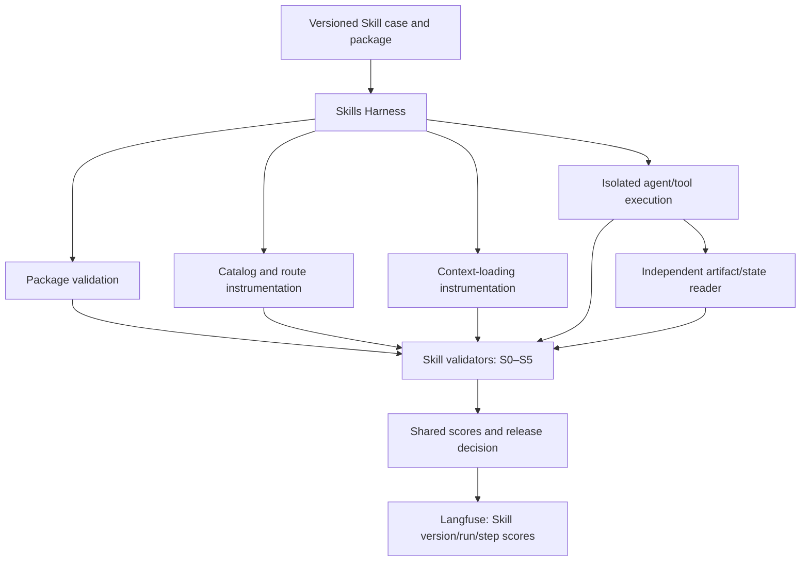

# Skills Evaluation — Dedicated Harness

## 1. Purpose and boundary

Skills evaluation is a separate platform domain alongside [Agent and RAG evaluation](TECHNICAL_DESIGN.md). A Skill is an instruction/resource package that influences agent behavior; it does not necessarily have a callable function or entry point. The harness tests packaging, routing, loading, instruction adherence, execution and outcome, not just whether a Skill name appeared in an answer.

Build the Skill-specific runner and validators. Reuse the platform's jobs, isolation, versioned datasets, evidence, authorization, Score contract, reporting and Langfuse synchronization. Do not create a second database, scheduler, identity system or judge framework. Semantic checks may call the shared DeepEval rubric adapter; deterministic Skill validation remains independent of Agent/RAG metrics.

**Current status:** only fixture Skill-selection rules exist. This document specifies the target harness; no complete Skill runner or lifecycle instrumentation is implemented.

## 2. Harness structure

The harness coordinates package loading and execution through a verified runtime adapter. Catalog/context hooks and tool/artifact collectors supply facts; validators score them. Reuse the existing `SkillRoutingEvaluator`, `TrajectoryEvaluator`, `OutcomeEvaluator` and `SafetyEvaluator` rule concepts after versioned hardening. Their present fixture behavior is not evidence of live-stage support. Extend the existing execution/evaluator boundaries rather than introduce a parallel generic runner.

## 3. Modes and applicability

| Mode | Purpose | Required stages | Routing treatment |
| --- | --- | --- | --- |
| `static` | Validate a package without running an agent | S0 | Not applicable by explicit policy |
| `forced` | Test one Skill's instructions/execution with selection controlled by the harness | S0, S2–S5 | Record forced selection; do not claim routing accuracy |
| `routing` | Let an agent choose among an allowed catalog, including no-Skill cases | S0 for catalog packages, S1 | Selection-only capture stops before downstream actions and must confirm termination; loading/execution are not required for this mode |
| `integration` | Test unconstrained selection, loading and full task execution | S0–S5 | Required/forbidden/alternative routes evaluated |

Every stage has declared required criteria. Mode-based not-applicable decisions are resolved before launch, not after a failure. Full platform acceptance includes all modes and all stages. A static pass cannot establish runtime readiness. A routing-only run does not prove task completion. No-Skill integration cases require observed non-selection and independently verified task outcome, with S2–S4 explicitly inapplicable to an absent Skill; they still prohibit unauthorized calls.

## 4. Versioned case contract

A Skills case uses the shared case schema with `evaluation_domain=skills` and includes:

- Mode, task input, package identity/content hash and versioned allowed catalog. Capture all referenced instructions, scripts, templates, dependencies and runtime/agent configuration, not only `SKILL.md`.
- Environment seed, permission/network policy, model/prompt settings, budgets and target runtime version.
- Private expected routing alternatives, forbidden Skills/actions, required step constraints and artifact/business-state assertions.
- Required evidence/stages/criteria, optional semantic rubric, thresholds and failure taxonomy.

Route alternatives are complete allowed route specifications: each declares required selected IDs and an allowed set containing them. The forbidden set applies globally and must be disjoint from every allowed set. A no-Skill route has empty required/allowed sets. A route passes when its required set is selected, all selected IDs fit its allowed set and no forbidden ID occurs. At least one declared alternative must pass; contradictory alternatives are rejected before execution.

Selections are scoped to the declared case/turn/agent. Preserve all attempts, and check forbidden selections/actions over the complete run. Stage scoring must bind to the same valid route and Skill versions, rather than borrowing required steps from one alternative and outcome assertions from another. Precision/recall/F1 is reported only on cases with explicit canonical labels; acceptance of alternatives does not turn every permitted Skill into a mandatory label. Exact no-Skill behavior is reported separately, avoiding division-by-zero conventions hidden in a score.

Agent-visible input excludes expected routes, step assertions and judge references. The runtime may load the Skill's public instructions; the test answer key remains outside its accessible filesystem/context.

## 5. Evidence and validators

| Stage | Evidence | Required checks |
| --- | --- | --- |
| S0 Packaging | Parsed manifest and immutable package/resource snapshot | Supported frontmatter, declared dependencies/resources, safe paths, missing references and package policy; static scanning is not proof of runtime safety |
| S1 Discovery/routing | Available catalog and explicit selection observations, scoped by run/turn/agent | Required, forbidden, alternative and no-Skill routes; separate unavailable discovery from agent mis-selection |
| S2 Loading | Runtime context-loading observation with Skill content hash/version | Correct instructions/resources actually supplied, version consistency and load failure; catalog scan alone does not count |
| S3 Adherence | Observable steps, tool arguments, artifacts and permission decisions | Required steps/causal dependencies, prohibited behavior and conflicting instructions; do not demand private reasoning |
| S4 Execution | Attributable tool/script calls, target, arguments, result/exit status, retries and permission audit | Correct execution boundaries, failure handling, idempotency and no forbidden side effects |
| S5 Outcome | Independent artifact/service snapshots and expected schema/semantics | Artifact exists and parses, required content/schema is correct, correct business objects/counts and forbidden changes absent |

The pinned runtime must expose a capability table for each stage: directly observable, requires instrumentation or unsupported. Mandatory missing capabilities block acceptance until instrumented or a compatible target is verified. Do not synthesize success events from prose or infer Skill ownership from a tool name or timestamp.

Use source-backed `skill_selected` and `skill_loaded` records where supported. Derive `skill_executed` from explicitly attributed actions, and `skill_completed` only from the harness's completed stage validation; the latter is a result, never input proving its own success. Events include shared run/attempt/turn/agent/call/causal IDs plus Skill package hash and source. Attribute downstream subagent work through explicit parent/Skill invocation links.

Packaging-only Skills may not execute scripts; S4 checks the downstream actions they actually require. Validate file artifacts through the sandbox boundary with size/path/symlink controls and content-specific parsers; an exit code of zero or an existing filename alone is insufficient. Read service state independently of the agent. Validators consume retained evidence after cleanup so re-evaluation does not need live execution.

Semantic adherence/output checks use an explicit versioned rubric and the shared DeepEval judge only when deterministic validation is insufficient. Retain judge configuration, input/output and evidence references; human-labelled calibration is required. Judge failure blocks required scoring and cannot override a demonstrated permission, safety or state violation.

## 6. Execution and decisions

1. Validate mode, package/catalog, route alternatives, criteria and runtime capabilities; freeze versions and private assertions.
2. Allocate isolated run resources, seed state and limit allowed Skill visibility. Capture initial service/filesystem state where applicable.
3. Execute static validation, controlled Skill loading, observed routing or full integration as declared. Collect stage and tool evidence under the shared deadline/budgets.
4. Stop/reconcile remote work, capture final artifacts/state and commit complete redacted evidence manifests. Unknown effects, missing evidence or ambiguous attribution block the sample.
5. Run stage validators and optional semantic judge. Clean up/quarantine through shared environment lifecycle.
6. Finalize shared case/experiment decisions; synchronize versioned scores and evidence references to Langfuse.

Required violations are `fail`; missing/untrustworthy evidence, evaluator exceptions or incomplete execution are `blocked`. Both prevent release. Cleanup status and failed attempts remain part of the decision. Do not let a high average adherence score compensate for forbidden execution or an invalid required artifact.

Scores use IDs such as `skills.packaging`, `skills.routing`, `skills.loading`, `skills.adherence`, `skills.execution`, `skills.outcome` and `skills.safety`, with criterion/evaluator version, stage/scope, evidence and reason. Preserve detailed failure codes: `package_invalid`, `not_discoverable`, `not_selected`, `false_trigger`, `forbidden_selected`, `load_failed`, `version_mismatch`, `instruction_violation`, `tool_error`, `invalid_output`, `outcome_mismatch`, `conflict`, `security_violation` and `evidence_missing`.

## 7. Version comparisons and test matrix

Compare candidate and prior Skill packages under the same case/catalog, model/prompt, knowledge snapshot, tool seed and judge/policy versions except the intended Skill change. Run independent repetitions with fresh memory/files/services. A no-Skill control measures contribution separately from forced-mode execution quality. A routing result and forced execution result cannot be merged into a claim that an unconstrained integration run passed.

Required test cases cover malformed metadata, missing resources, path escape, wrong package version, failure to discover/select/load, irrelevant and forbidden selection, valid alternative routes, no-Skill cases, missing/reordered required steps, incorrect arguments, tool failures/retries, permission denial, false completion, invalid/missing artifacts, wrong/duplicate business objects, conflicting Skills, prompt injection attempts, evidence loss, concurrent run isolation, cancellation and cleanup failure. Include negative tests that fail despite a plausible final answer.

The console exposes Skills mode/package/catalog configuration, S0–S5 results, failure evidence, prior/candidate/no-Skill comparisons and release decisions. Langfuse displays linked traces and custom scores; private references and restricted artifacts are not copied into unrestricted trace views. Use the shared transactional outbox, access controls and retention/deletion rules.

## 8. Acceptance boundary

The [complete acceptance checklist](ACCEPTANCE.md) requires all modes, verified S0–S5 instrumentation, alternative/no-Skill cases, independent outcome validation, deterministic failure detection, calibrated semantic checks and concurrent/recovery behavior. Unsupported evidence is a tracked blocker, not a silently omitted stage. This design is implemented within the same full-platform delivery scope as Agent and RAG.
