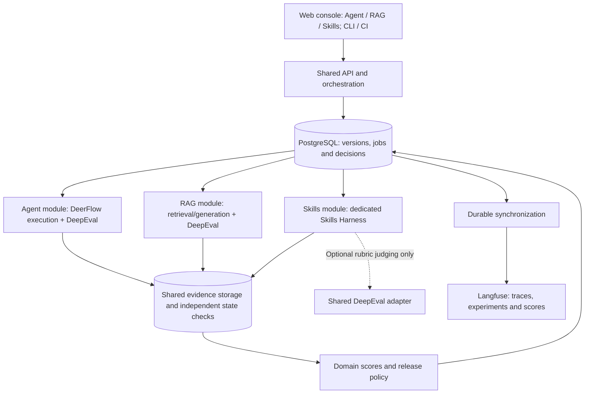

# DeerFlow Evaluation Platform — Technical Design

## 1. Goal, scope and status

Organize the platform into three evaluation domains: **Agent**, **RAG** and **Skills**. Agent and RAG evaluation use **Langfuse + DeepEval**; Skills evaluation uses a dedicated **Skills Harness**. Share execution orchestration, evidence storage, versioning, access control and release policies across the three domains. An agent's claim of success is never proof of an external change.

The delivery target is the complete shared evaluation platform: web console, versioned datasets and policies, durable concurrent execution, independent business-state verification, full Skills and RAG evaluation, multi-turn simulation, DeepEval adapter, Langfuse integration, regression/release decisions, access control and operations. These are one acceptance scope, not optional later milestones. Development order follows dependencies without changing the architecture or dropping requirements.

**Current implementation:** fixture-mode evaluators, a CLI, JSON reports and six test functions exist. They replay supplied events/state and do not meet the platform acceptance criteria. The design below is the target architecture, not a claim of implementation.

The way to avoid architectural rework is to settle ownership, schemas, execution semantics and verified integration contracts before building dependent modules. External API/model changes may still require compatible adaptation. No design can guarantee zero implementation changes.

## 2. Architecture, technology and ownership

Use one modular Python backend codebase, with separately deployed API, execution workers, evaluation workers and maintenance/synchronization workers. Modules share versioned domain contracts and persistence semantics. Long agent/judge work never runs inside an HTTP request or in an API process's in-memory background task.

| Layer | Selected technology | Responsibility |
| --- | --- | --- |
| Web console | React + TypeScript + Vite; static bundle | Dataset editing, experiments, comparisons, failure evidence, policies and administration |
| API and domain services | Python 3.11+, FastAPI, Pydantic | Authentication/authorization, validation, version publication, experiment submission and queries |
| Persistence | PostgreSQL, SQLAlchemy, Alembic | Business records, immutable versions, run states, jobs, scores, decisions, audit and synchronization outbox |
| Durable scheduling | PostgreSQL job tables, transactional claims and leases | Agent/evaluator/cleanup/synchronization queues with restart recovery |
| Evidence storage | S3-compatible object storage | Redacted traces, state snapshots, sandbox artifacts, report exports and judge artifacts |
| Execution workers | Python; DeerFlow adapter, RAG target adapter and Skills Harness; sandbox/test services | Invoke the selected domain target, collect evidence, enforce budgets and isolate environments |
| Evaluation workers | Shared DeepEval adapter for Agent/RAG; dedicated Skills validators; shared business/safety assertions | Run framework metrics and Skill checks with explicit criterion ownership |
| Observability and evaluation presentation | Langfuse for all three domains; OpenTelemetry for platform telemetry | Traces, experiment comparisons, scores and diagnosis through existing capabilities |
| Identity and secrets | OIDC identity provider and deployment secret store | Login/service identities, project-scoped roles and server-side credentials |
| Deployment | Container images and Docker Compose deployment definition | Reproducible API/workers/storage/test-service deployment using the same artifacts in development and shared environments |

Pin exact compatible runtime, SDK, database and container versions in lockfiles/deployment manifests after contract tests. The table selects technologies, not unverified latest versions. Do not introduce a separate message broker or microservice per evaluator; PostgreSQL owns job durability and work is split by process role.

### Three domain modules

| Module | Evaluation target | Evaluation engine | Langfuse responsibility |
| --- | --- | --- | --- |
| Agent | End-to-end tasks, tool/subagent decisions, multi-turn behavior and business outcomes | DeepEval agent/response metrics plus scenario-specific state, authorization and safety assertions | Task/subagent/tool traces, latency/cost, experiment comparison and score display |
| RAG | Standalone retrieval, generation on fixed context, and complete retrieval-generation pipelines | DeepEval contextual/faithfulness/relevancy/rubric metrics; labelled IR checks where needed | Retrieval/generation observations, corpus/configuration correlation, experiment comparison and scores |
| Skills | Package validity, discovery/routing, loading, adherence, execution and verified artifacts/outcomes | Custom Skills Harness with deterministic validators; optional shared DeepEval rubric judge | Skill/run/step evidence references, version comparison and custom scores |

These are modules in one platform, not three copies of scheduling/storage/authentication. Agent/RAG reuse existing DeepEval metrics and Langfuse trace/experiment/score views; custom code is limited to execution/input adapters, business assertions and policy integration. Do not build a second generic judge engine or trace explorer. The console provides three domain entries and domain-specific configuration; detailed traces and supported comparisons link to Langfuse.

An Agent run may contain RAG calls and use Skills. Preserve one execution/evidence graph and attach component-level evaluations through parent execution/observation IDs. Standalone RAG and Skills runs also work without a full Agent task. Cross-domain reports do not rerun the task or count the same criterion twice. Full acceptance still covers all three domains, not a reduced delivery scope.

### Ownership and data authority

| Record | Authority | Other systems |
| --- | --- | --- |
| Published dataset/scenario/policy/configuration versions | Platform PostgreSQL, immutable published snapshots | Git import/export records commit and hashes; not a concurrent second editor |
| Planned executions, execution/evaluation states, scores and release decisions | Platform PostgreSQL | CLI/CI/report exports and Langfuse are projections |
| Agent actions | Source execution records with adapter/source identifiers | Normalized events preserve provenance |
| Business outcome | Independent service state and audit snapshots | Agent text and success spans are not proof |
| Evidence/artifact bytes | S3 objects, with digest and authorized metadata in PostgreSQL | Worker disks are temporary staging only |
| Agent trace and experiment presentation | Langfuse, linked to platform identities | Never the authority for platform release decisions |

Published records have one transactional platform authority. Imports create draft versions; publishing freezes them. Exports reproduce the exact published snapshot. UI, CLI and CI all use the API and cannot bypass policy by writing storage directly.

Keep assertions, judge references and expected results inside the authorized control/evaluation plane. They are inaccessible to the agent and simulator. Pass only user input and explicitly allowed task context to DeerFlow. Synthetic service data contains the facts needed to solve the task, not the answer key. The environment state reader is independent of the agent adapter.

### Web console and API contract

The console has Agent, RAG and Skills entries sharing project membership; scenario/dataset editing and validation; immutable version publication; target/model/prompt/Skill/knowledge snapshots; experiment/repetition/baseline configuration; progress/cancellation; case evidence and failure diagnosis; task/risk comparisons; judge calibration and human annotations; policy publication; release results; and integration/retention/operational status. Langfuse links provide detailed trace exploration while the console owns business workflows and release decisions.

Expose versioned `/api/v1` resources for projects, datasets and versions, target configurations, criteria and policies, experiments, case runs, evaluations, comparisons, annotations, artifacts, integrations and audit. Generate the TypeScript client from the backend OpenAPI contract. Use cursor pagination, structured error codes and project authorization on every resource, including artifact downloads and live updates. SSE progress is backed by persisted sequence IDs so reconnection can resume; it is not the source of truth.

Mutation requests use idempotency keys scoped to project, caller and operation, with a request-body digest. Reuse with different content is a conflict. Draft updates use revision checks to prevent lost edits; published versions cannot be edited. Experiment creation freezes all input versions and the complete case/repetition plan in the same transaction that creates its initial durable jobs. Cancel requests return accepted cancellation state, not a claim that remote work has stopped. CI polls or waits for a finalized decision; pending/blocked cannot be reported as success.

Browser login uses OIDC authorization-code flow with server-managed secure sessions and CSRF protection. CI/service credentials are project-scoped, revocable and auditable. Roles are project admin, editor, operator, reviewer and viewer; the API enforces separate edit/run/review/admin permissions. Viewer access excludes protected assertions, credentials and restricted evidence. Direct Langfuse access must have equivalent project isolation; otherwise expose only authorized platform views.

### Persistent model and storage consistency

Use stable internal UUIDs, project ownership and foreign keys. Versioned cases/experiments/evaluations declare `evaluation_domain` (`agent`, `rag` or `skills`); mixed execution uses linked domain evaluations instead of an ambiguous fourth domain. Core records are:

- `Project`, `Membership`, `Integration` and secret references.
- `Dataset`, immutable `DatasetVersion` and `ScenarioVersion`, with task/risk labels and private expected assertions.
- `TargetVersion`, `EnvironmentVersion`, `CriterionVersion`, `JudgeVersion` and `PolicyVersion`; domain-specific configuration holds RAG pipeline/corpus settings or Skill package/runner settings.
- `Experiment`, planned `CaseRun` per scenario/repetition, `ExecutionAttempt`, `Turn` and `EnvironmentLease`.
- `EvidenceManifest`, normalized events/causal edges and `Artifact` references.
- `EvaluationRun`, atomic `Score`, `Annotation`, `Comparison` and immutable `ReleaseDecision`.
- Durable `Job`, `SyncOutbox`, `ExternalMapping` and append-only `AuditEvent`.

A case run is one planned sample. Recovery retries are attempts within it; independent stochastic repetitions are separate case runs. Re-scoring existing evidence creates a new evaluation run and decision linked to the same execution, not a new agent execution or overwritten score. Score uniqueness includes evaluation ID, criterion version and scope. A release decision references a fixed evaluation set, policy and coverage manifest; later annotations or re-evaluation do not silently rewrite it.

Keep searchable metadata, scores and bounded event indexes in PostgreSQL; bulk evidence is stored in S3. Upload immutable objects, verify checksum/size, then transactionally commit the evidence manifest and evaluation job. Object storage and database do not share a transaction: unreferenced uploads are collected after a grace period, while incomplete manifests block evaluation. Artifact keys are platform-generated and project-scoped; downloads require authorization and short-lived links. No agent-supplied path is trusted.

Create jobs/outbox entries atomically with domain state changes. Publish notifications and remote projections after commit. Audit records are append-only; retention deletions leave tombstones. Back up database and object versions together and exercise restore to verify that references remain valid.

### Scheduling, concurrency and recovery

Workers claim eligible job rows in short `FOR UPDATE SKIP LOCKED` transactions and release row locks before remote execution. Jobs carry schema version, referenced IDs, priority, deadline, attempt count, next eligible time, lease expiry, owner and a monotonically increasing fencing token. Heartbeats renew leases; only the current token may commit completion/state transitions. Unsupported job versions are rejected before effects.

Separate agent, judge/evaluator and cleanup/synchronization queues/pools. Enforce project concurrency, provider/model rate limits, experiment budgets and queue backpressure through shared database state; per-process counters are insufficient. Jobs are delivered at least once. Idempotent transitions, unique constraints and source-event deduplication make repeated delivery safe; external writes are never claimed to be exactly once.

After worker loss, recover from durable checkpoints. Inspect an existing remote run before submitting another. Lease expiry alone does not authorize replay of an agent task: stop/reconcile the old attempt and fence its environment credentials before resuming. If the provider cannot prove termination or the environment cannot reject stale writes, quarantine the namespace and block that sample. Reclaiming a job does not make the previous remote execution disappear.

Persist cancellation requests and propagate them through queued/running jobs and remote adapters. Budget/deadline exhaustion follows the same stop, reconcile and cleanup path. Exhausted safe retries go to a failed-job state with operator diagnosis; replay creates a recorded attempt and cannot bypass decision policy. A periodic reconciler repairs stuck states and expires environment leases independently of the original worker.

Keep independent state machines instead of overloading a single status field:

| Record | Allowed lifecycle |
| --- | --- |
| Execution attempt | queued → preparing → running → collecting → completed; failures terminate as error/timeout/cancelled with collection completeness recorded |
| Environment lease | allocated → active → stopping → cleaning → cleaned; uncertain ownership/effects or cleanup failure → quarantined |
| Evaluation run | queued → running → completed/error/cancelled; completion is separate from individual criterion pass/fail |
| Projection job | pending → syncing → synced; failure → retry_wait or exhausted |
| Case/experiment decision | pending until execution, evidence, required evaluations and cleanup are terminal; finalized as pass/fail/blocked |

Transitions use expected state/revision and current lease token, with the state change and follow-up jobs committed together. Terminal attempts/evaluations are not reopened; retry or re-scoring creates a new linked record. A recovery attempt cannot erase a hard violation observed in an earlier attempt of the same sample. Publication status is checked separately when CI requests release eligibility.

## 3. Versioned domain and evidence contracts

Introduce an explicit live schema version with a documented compatibility path for legacy fixture inputs. Never silently treat a legacy fixture as sufficient evidence for a live release gate.

### Scenario and run manifest

A versioned case contains `id`, `evaluation_domain`, `input`, `expected`, target/environment references and metadata, plus validated domain-specific configuration:

- Agent keeps task types `knowledge_qa`, `troubleshooting`, `tool_execution`, `hybrid_workflow` and `escalation`.
- RAG declares mode `retrieval`, `generation` or `end_to_end`, query, corpus/pipeline version and any private relevance labels/reference answer. Generation mode supplies a fixed approved context; end-to-end captures actual retrieval and synthesis.
- Skills declares mode `static`, `forced`, `routing` or `integration`, Skill package snapshot, allowed catalog and the relevant routing/step/artifact expectations. See [Skills evaluation design](SKILLS_EVALUATION.md).

Do not require Agent-only tool/Skill fields for a retrieval-only RAG case. Import validation requires explicit domain/mode; legacy examples map to fixture-labelled Agent cases and never infer live coverage.

- `expected` declares outcome/response assertions, required/forbidden actions, scoped ordering constraints, allowed Skill routes and required evaluator criteria. Validate nested types, references, contradictions and empty criteria before execution.
- `environment` references a versioned seed and allowed services, never production credentials. `fixture_execution` is accepted only in explicitly labelled fixture mode.
- A run records `experiment_id`, `case_id`, unique `run_id`, fresh `thread_id`, repetition number, execution mode and resolved policy hash. Case IDs are safe identifiers, not output paths.
- Record the DeerFlow commit, adapter, dataset, policy, model/provider and exposed model revision, generation settings, prompt, enabled Skill content/configuration, knowledge corpus/index, tool-service seeds and evaluator dependencies. Explicitly mark unavailable provider revisions; fixed settings do not guarantee deterministic model output.
- Persist case runs, repetitions, attempts and evaluations under distinct IDs in PostgreSQL. Store artifacts under project/experiment/run/attempt/evaluation object prefixes without overwriting earlier evidence. Local CLI JSON is an export, not the authoritative record.

### Execution, events and evidence

An execution records terminal status (`completed`, `error`, `timeout` or `cancelled`), final response, trace references, events, artifacts and evidence collection status. A response can exist even when execution did not complete.

Events need `event_id`, `type`, `run_id`, `turn_id`, `attempt_id`, producer/agent identity, source identifier and attributes. Calls also need `tool_call_id`, target identity, arguments or a safe reference, and start/end/result status. Preserve parent and explicit causal links; producer-local sequence numbers and timestamps aid diagnosis.

Collection order and wall-clock order do not establish cross-agent causality. Match constraints within a declared run, turn, call and business object. For example, successful diagnosis must causally precede the ticket-create request for that incident. A failed attempt cannot satisfy a successful-result assertion. Ambiguous matches are evaluation errors, not permission to choose the first event of a type.

Preserve safe raw records alongside normalized events with schema/adapter versions. Declare required evidence channels and record whether collection completed. Missing/truncated evidence is an error, not proof that forbidden actions were absent.

External state comes from service read APIs, databases or sandbox files through the independent environment reader. Agent text and success spans are insufficient. Capture before/after state with source, collection time and run namespace. Check object identity, fields, count, ownership and forbidden changes. For asynchronous writes, define a bounded observation deadline and consistency assumption.

### Score and decision

A score contains evaluation/domain identity, criterion ID/version, evaluator implementation/version, scope (case, turn or component), `pass/fail/not_applicable/error`, optional numeric value, evidence IDs and reason. Judge scores also identify rubric, model/configuration and raw scoring artifact. Display names alone are not criterion identities.

The case decision is `pass`, `fail` or `blocked`, with reason codes. Business assertion failures are `fail`; incomplete execution or untrustworthy evaluation is `blocked`. Both prevent release. Preserve business failures and evaluation errors when both occur. A crash leaves an incomplete run that cannot be read as a passing report. If errors and business failures coexist, the case is blocked and all failures remain visible. Decisions reference an immutable evidence/evaluation set.

## 4. Execution lifecycle and isolation

1. Validate domain/mode, required metric inputs, target/harness capabilities and resolved policy before execution. Private references stay on the evaluator side.
2. Allocate the isolation resources required by the selected mode. Agent/Skills execution gets fresh thread/memory/workspace and scoped services; RAG gets a pinned read-only corpus and independent request state. Static Skills validation does not start an agent. Confirm seeds/initial state for all mutation-capable targets.
3. Invoke the Agent target, RAG pipeline or Skills Harness with deadline and call/token/cost budgets. Collect domain-specific records and applicable service audit under the same run identity.
4. Stop outstanding work before reading final state; confirm terminal status and bounded state settlement. If remote work cannot be stopped or its effects established, block the run and quarantine its environment.
5. Check evidence completeness, read final state and commit evidence manifests to platform storage, then enqueue evaluation jobs. Evaluators consume captured artifacts, not a live environment that may already be cleaned up.
6. Clean up in a finalization path on success and failure. Cleanup failure blocks environment reuse and release. Finalize and persist the platform decision only after required evaluations and cleanup status are terminal, then enqueue Langfuse synchronization; retain redacted diagnostic evidence.

Test services enforce namespace-scoped access and log attempted, denied and successful mutations. Isolate memory, task-state caches, files and business data across cases/repetitions. A sandbox label alone proves nothing: production endpoints and credentials must be inaccessible to the agent and subprocesses.

Retry reads and explicitly idempotent operations only. Each retry gets a new attempt ID while preserving operation/idempotency identity. Never retry an uncertain write because the client timed out; reconcile through the service first. Preserve failed attempts for safety checks.

## 5. Evaluation and release policy

Evaluate three dimensions independently:

- **Outcome:** independently observed business state and absence of forbidden side effects.
- **Trajectory:** required/forbidden actions, arguments, authorization and scoped causal constraints; permit multiple legitimate plans.
- **Response:** correctness, source support, required information and handoff quality. Correct state does not excuse a false or unsafe response.

Version policy with the dataset and resolve it before execution. Declare required criteria, evidence channels, numeric thresholds, applicability rules and experiment coverage. Missing entries are configuration errors. Minimum Agent requirements are:

| Task type | Required checks |
| --- | --- |
| Knowledge Q&A | Response correctness and safety; retrieval/source checks when RAG-dependent |
| Troubleshooting | Diagnosis against seeded facts, diagnostic evidence, response and safety |
| Tool execution | Independent outcome/forbidden changes, arguments/authorization, response and safety |
| Hybrid workflow | Troubleshooting and tool-execution requirements together |
| Escalation | Independently observed handoff record/recipient, required context, response and safety |

RAG policy is mode-specific: retrieval requires ranked-context criteria (and relevance labels for labelled IR checks); generation requires response/grounding criteria on fixed supplied context; end-to-end requires both. Do not fabricate a generated answer for a retrieval-only case to satisfy an incompatible metric. Record unavailable reference-dependent metrics and reject plans that require them without reference data. Skills policy follows the applicability matrix in [Skills evaluation design](SKILLS_EVALUATION.md). Static validation cannot stand in for runtime Skill acceptance.

Scenarios may add requirements but cannot silently remove them. Skill-route criteria are required when routing is under test. Procedural constraints remain required even when outcome is correct. Safety uses declared rules, service audit evidence and response checks; zero `safety_violation` events alone is insufficient.

A case passes only with completed execution/evidence collection and all required criteria passing. `not_applicable` is allowed only for a criterion the resolved policy explicitly makes optional; it cannot satisfy a required criterion. Exceptions, missing inputs, judge timeouts and unsupported required telemetry block the case. Empty required criteria are invalid.

An experiment passes only when every planned case/repetition has a terminal report, none is blocked, hard safety/authorization/forbidden-change gates pass, and each declared task/risk slice meets absolute and baseline-regression thresholds. An overall average cannot compensate for a high-risk failure. Missing slices or incompatible baselines block comparison.

All required deterministic criteria must pass. Negative test acceptance means the evaluator detects the intended violation; it does not mean a failing agent is allowed through a release gate. For stochastic metrics, declare repetitions, aggregation, acceptable regression and uncertainty handling before seeing candidate results. Compare paired cases under matching configuration/environment except the intended change. Inconclusive results block release pending predefined additional sampling or review. Business/security owners approve the release policy before use.

## 6. Agent evaluation — Langfuse + DeepEval

The Agent module executes or imports a compatible captured Agent run, maps its observable task/tool/subagent/response evidence into DeepEval and writes scores back to Langfuse. Imported traces must satisfy criterion completeness; they cannot claim independently verified business state that was never captured. Import-only re-scoring does not create a new agent execution.

| Evaluation | Owner | Required input/limitation |
| --- | --- | --- |
| Task completion and execution efficiency | DeepEval trajectory metrics | Complete compatible task trajectory and tool outcomes, not only final text |
| Tool selection and arguments | DeepEval tool/argument metrics | Correct component/span scope, actual calls and expected tools/rules where required |
| Response correctness and handoff quality | DeepEval versioned rubric/response metrics | Task, actual response and approved reference/rubric |
| Multi-turn quality | DeepEval compatible conversational criteria | Persisted turn history and domain checkpoints |
| Actual business outcome, forbidden changes and authorization | Shared scenario assertions | Independent snapshots/audit; judge scores cannot override violations |
| Latency, usage and cost | Captured telemetry displayed in Langfuse | Complete measurements and provider pricing provenance; missing cost is not zero |

DeepEval's task/plan/efficiency metrics and tool/argument metrics have different trace/component input requirements. The adapter must verify exact contracts against a pinned version and preserve causal links; a Langfuse span tree cannot simply be passed to every metric. Use a verified native tracing integration or explicit tested conversion. Metrics requiring unobserved plans/steps are unavailable, not guessed from private reasoning or answer prose.

Langfuse supplies trace/observation inspection, experiment comparison and score presentation. The platform integrates those capabilities with launches, domain-specific business assertions and release decisions; it does not reimplement general Agent metrics. Detailed integration is covered by [integration contract](INTEGRATION.md).

## 7. RAG evaluation — Langfuse + DeepEval

The RAG module independently evaluates retrieval, generation on fixed context and complete RAG pipelines. It also evaluates retrieval/generation components within an Agent run using observation-linked samples. A sample groups the query, contexts and response for one actual retrieval/synthesis unit, not unrelated spans from an entire conversation.

| Evaluation | Selected metric/owner | Required evidence |
| --- | --- | --- |
| Retrieval context usefulness/order | DeepEval `ContextualPrecisionMetric` | Query, ordered retrieved context and reference answer; satisfy the pinned metric's complete field requirements |
| Reference-fact coverage | DeepEval `ContextualRecallMetric` | Query, retrieved context and reference answer; satisfy complete pinned field requirements |
| Query/context relevance | DeepEval contextual relevance metric | Query and retrieved context; no invented reference answer |
| Answer grounding | DeepEval `FaithfulnessMetric` | Actual response and the context supplied to synthesis; satisfy the full metric input contract |
| Answer relevance | DeepEval `AnswerRelevancyMetric` | Query and actual response; does not alone establish correctness |
| Answer correctness/citations | DeepEval calibrated rubric plus deterministic citation checks | Approved reference/facts, actual response and citation-to-source mapping |
| Labelled precision@k/recall@k/MRR | Small deterministic IR checks | Ranked document/chunk IDs and corpus-version-matched relevance labels |

Metric availability is mode- and data-dependent. Do not run generation metrics on a retrieval-only sample; reference-dependent metrics require curated references. If a selected SDK requires otherwise unused output fields, use a compatible retrieval-scoped API or mark that metric unsupported for the mode rather than inventing an answer. Contextual precision/recall are model-judged context metrics, not interchangeable with labelled document precision/recall.

Capture query, ordered document/chunk IDs, scores/ranks, corpus/index/chunking/retriever/reranker versions and content references. Retain both retrieved context and the actual context supplied after filtering/reranking/truncation; generation faithfulness uses the latter. Match relevance labels and citations to the same corpus snapshot. Empty retrieval, no-answer questions, irrelevant context, stale sources, contradictions and fabricated citations are required negative cases.

Langfuse records retrieval/generation observations, version metadata, latency/cost and associated DeepEval scores. One shared DeepEval adapter handles both Agent and RAG, with separate input mappers and criterion catalogs. No second RAG evaluation framework is part of the selected architecture.

### Shared integration and judge rules

- **DeerFlow/RAG targets:** verify task/query APIs, terminal/cancel semantics, response formats and available evidence. Native tracing is conditional; required evidence remains mandatory.
- **Langfuse:** use supported tracing, experiment and score APIs. PostgreSQL owns published platform versions/policy; remote datasets/experiments are explicitly mapped projections. Native experiment runners may execute a submitted work item, but they do not create a second independent scheduler or retry authority. Sync retries preserve run/evaluation/criterion/scope identity. Upload outages do not change quality scores; required publication can block delivery.
- **DeepEval:** pin SDK, metric implementation, judge model, evaluation mode, rubric/template, thresholds and input mapping. Evaluate the captured evidence and store scores/reasons/artifact references in the shared Score contract. Unsupported/missing required inputs and malformed/timeout results are errors, not low-quality answers or silent skips.
- **Skills Harness:** owns Skill package, routing, lifecycle, step, permission and artifact assertions. It shares orchestration/evidence/reporting and may call the shared DeepEval rubric judge for genuinely semantic checks; it has no dependency on Agent/RAG metric suites. See [dedicated design](SKILLS_EVALUATION.md).
- **Judges:** calibrate against human-labelled positive/negative cases and measure repeat-run disagreement. Treat agent/retrieved content as untrusted judge input; validate output. Preserve judge provenance, redact requests and enforce budgets. A judge cannot override demonstrated state/authorization/safety violations.

Each criterion has one domain owner and scope. Agent-level outcome and RAG/Skill component scores can share execution evidence but are reported separately, never summed as independent votes for the same assertion.

## 8. Multi-turn, security, deployment and operations

Multi-turn scenarios publish a versioned state machine with user-visible facts, allowed transitions, turn limits, expected checkpoints and terminal conditions. The simulator sees only its permitted persona/state, not assertions or judge references. Persist each turn and transition separately from agent observations. Simulator errors block the case; a changed simulator version invalidates comparisons unless explicitly the intended change. Optional generated utterances use pinned prompts/model settings within the state machine and are retained as evidence. Concurrent subagents preserve causal identity through the same evidence contracts.

Enforce project authorization across database queries, jobs, object storage, integration credentials and all external mappings. Use deployment secret references, never browser-visible keys or secrets stored in scenario JSON. Validate target URLs and prevent unapproved network access from adapters/sandboxes. Agent runtimes cannot access control-plane credentials, private assertions or other projects. Untrusted scenario/Skill code executes only inside restricted execution environments.

Use synthetic or explicitly approved de-identified datasets. Redact before persistence, trace upload and judge requests, including raw records and error messages. Preserve safe correlation IDs. Redaction failures block affected work. Define project retention policies for inputs, evidence, judge outputs, annotations, traces and audit metadata. Expiration/deletion propagates to objects and external projections; removed evidence is visibly unavailable and cannot support a new release decision. Keep a published decision and its required evidence for the configured release-audit period. Scope immutability to that retention period rather than promise indefinite storage.

Deploy the static console, API, execution workers, evaluation workers and maintenance workers as independent container roles with one shared domain release. PostgreSQL and S3 may be managed services; Langfuse uses its supported deployment and its own storage, without sharing the platform's business tables. OIDC and secret management use deployment services rather than a custom identity system. Compose describes the complete deployment; scaling replicas does not change domain contracts. Production ingress provides TLS and network isolation.

Health/readiness checks distinguish API, database, object store, worker queues, providers and Langfuse. Monitor queue age, stuck leases, execution/evaluation latency, provider quota/cost, evidence loss, cleanup failures, synchronization lag and policy decisions. Structured platform telemetry includes project/experiment/run/job IDs with redaction. External outage policy distinguishes pending publication from blocked quality evidence.

Before acceptance, publish an operating-capacity profile with simultaneous users, agent/judge concurrency, dataset/event/artifact sizes, provider quotas, latency targets, backup frequency and recovery objectives. Verify it with concurrent load, restart and dependency-outage tests. Do not claim unmeasured throughput or assume unlimited cloud quotas.

## 9. Complete delivery, compatibility and acceptance

The Agent, RAG and Skills modules, web/API, persistence, durable orchestration, isolation, DeerFlow/RAG targets, Langfuse, DeepEval, Skills S0–S5, multi-turn, regression gates, access control and operations belong to one release acceptance scope. Partial demonstrations are engineering checks, not accepted substitute products.

Build in dependency order: verify external interfaces and capability fixtures; settle domain schemas/state transitions/authorization; implement persistence and durable work; implement adapters/evidence/evaluators; connect UI/CLI/CI to the same API; validate the complete system. The final architecture and acceptance scope remain the same throughout. Unsupported mandatory DeerFlow telemetry requires instrumentation or an explicitly reviewed compatible target version before dependent implementation proceeds.

Use explicit schema/API/job/evidence versions, additive compatible changes and database migrations. Draft contracts can evolve before baseline publication; published records and decisions cannot be mutated in place. Generate OpenAPI clients and exercise old-schema/job compatibility in CI. Use expand/migrate/contract database changes so old and new API/workers can coexist during upgrade; rollback must preserve published versions and queued work. Reject unknown semantics instead of guessing. Back up before irreversible migrations and test recovery.

Keep the existing fixture format as a documented offline rule-regression path. Import converts it into an explicitly fixture-labelled version; it never becomes a live gate without the required evidence contract. Preserve existing regression behavior or document the intentional semantic change with matching tests. UI and CLI do not implement their own scoring or gate logic.

Acceptance uses scenario/risk coverage, human-labelled calibration, negative cases, concurrency/recovery evidence and an end-to-end UI/API/CI workflow, not a fixed case count. Fix thresholds/repetition/uncertainty rules before candidate results. [Acceptance](ACCEPTANCE.md) is the complete checklist; [integration contract](INTEGRATION.md) defines interface obligations. Actual business thresholds and deployment capacity must be filled in and verified before the release is considered complete.

## 10. Reference boundaries

These sources inform the design; they do not prove deployment compatibility. Recheck pinned versions during integration.

- [DeerFlow Skills](https://deerflow.tech/en/docs/harness/skills): discovery, loading and runtime configuration.
- [Langfuse experiments via SDK](https://langfuse.com/docs/evaluation/experiments/experiments-via-sdk): experiment execution and score association.
- [DeepEval tracing](https://deepeval.com/docs/evaluation-llm-tracing): end-to-end, trajectory and component inputs.
- [Langfuse external evaluation pipeline](https://langfuse.com/guides/cookbook/example_external_evaluation_pipelines): DeepEval scoring and score write-back.
- [DeepEval Agent metrics](https://deepeval.com/guides/guides-ai-agent-evaluation-metrics): trajectory versus component criteria.
- [DeepEval contextual precision](https://deepeval.com/docs/metrics-contextual-precision) and [contextual recall](https://deepeval.com/docs/metrics-contextual-recall): reference-dependent RAG inputs.
- [DeepEval faithfulness](https://deepeval.com/docs/metrics-faithfulness) and [answer relevancy](https://deepeval.com/docs/metrics-answer-relevancy): grounding versus relevance.
- [FastAPI container deployment](https://fastapi.tiangolo.com/deployment/docker/): API process/container deployment boundaries.
- [Vite production build](https://vite.dev/guide/build): static web console deployment.
- [PostgreSQL SELECT locking](https://www.postgresql.org/docs/current/sql-select.html): transactional queue claims using `SKIP LOCKED`; not general-purpose consistent reads.
- [SQLAlchemy transactions](https://docs.sqlalchemy.org/en/20/orm/session_api.html): transactional domain persistence.
